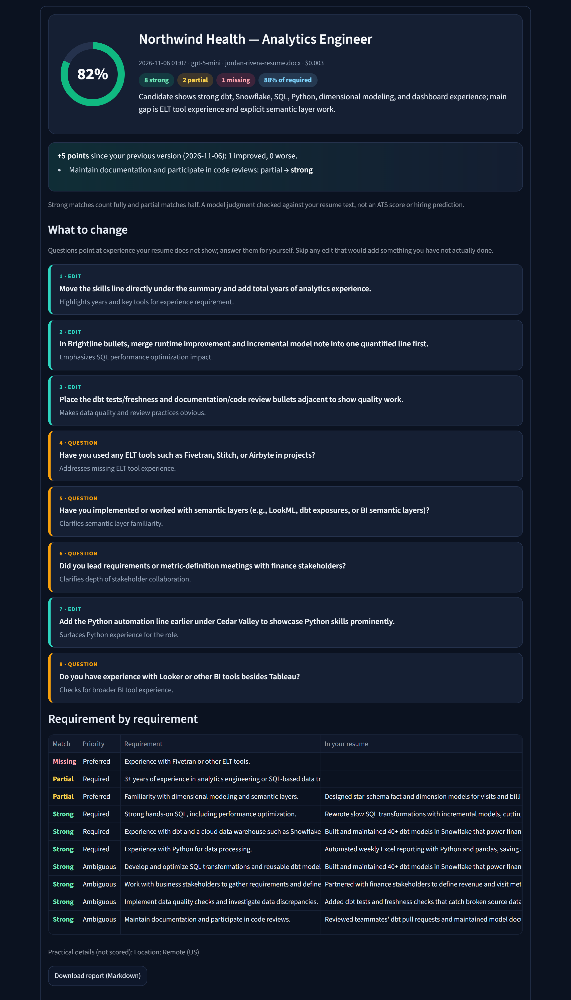
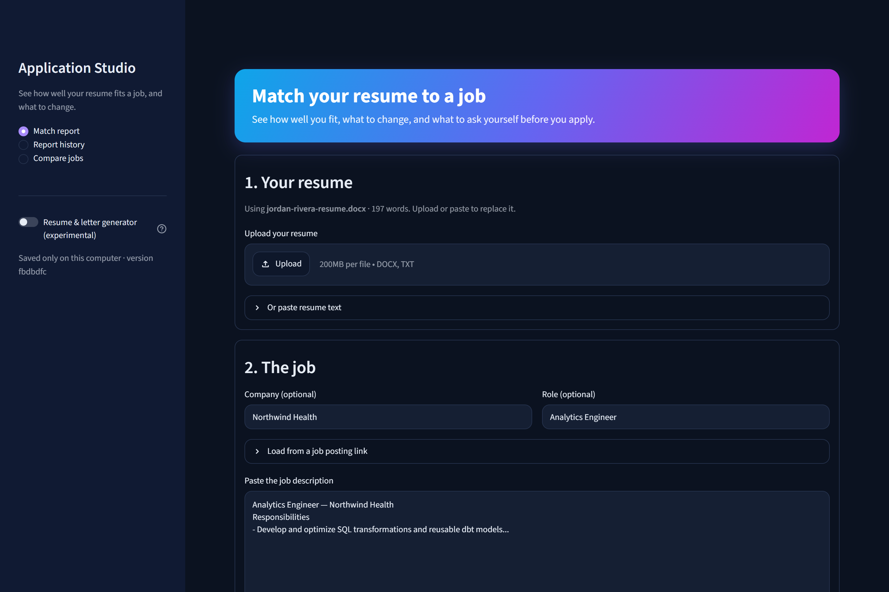
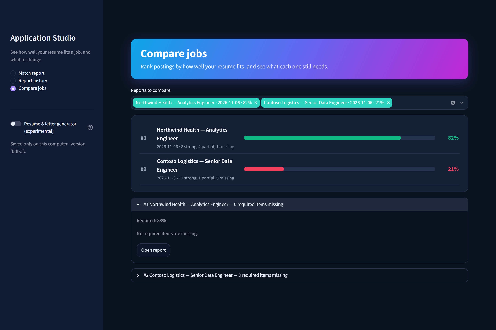

# Application Studio

See how well your resume fits a job posting, and what to change before you apply.

Application Studio is a small local web app (Python + Streamlit). You give it your resume once, paste a job
posting, and it produces a match report in about half a minute for well under a cent. It never writes or
changes your resume for you, and it never suggests claiming experience your resume doesn't show.

<p align="center"></p>

## What you get

- **Match score**: strong requirements count fully, partial ones half, plus a score for required items only.
- **Requirement by requirement**: every requirement in the posting rated *strong*, *partial* or *missing*,
  with the line from your resume that supports it. Each quoted line is checked against your actual resume
  text, so a strong rating always points at something you wrote.
- **What to change**: up to eight prioritized suggestions. *Edits* reword or reorder what is already in
  your resume; *questions* point at requirements your resume doesn't show ("Have you used Airflow?").
- **Re-score**: edit your resume, upload the new version, and re-score the same job to see which
  requirements moved and how much the score changed.
- **Compare jobs**: rank several postings by fit and see which required items each one is still missing.
- **History and export**: every report is saved locally and downloads as Markdown.

Practical details such as location or salary are listed but not scored. The score is a model judgment
checked against your resume text, not an ATS score or a hiring prediction.

| Start a report | Compare jobs |
|---|---|
|  |  |

_Screenshots use a fictional candidate and fictional job postings._

## Setup (Windows)

Requires Python 3.11+. From the repository folder in PowerShell:

```powershell
py -m venv .venv
.\.venv\Scripts\python.exe -m pip install -e ".[dev]"
```

Add an OpenAI API key as a Windows user environment variable named `OPENAI_API_KEY` (or
`CAREER_OPENAI_API_KEY`), then open a new terminal so it is picked up. API usage is billed separately
from ChatGPT plans; add credits at platform.openai.com → Settings → Billing.

Start the app:

```powershell
.\.venv\Scripts\python.exe -m streamlit run career_pipeline/ui.py --server.address localhost
```

and open http://localhost:8501. Without a key you can still try **Practice** mode, which only counts
shared words.

On macOS/Linux, use `python -m venv .venv` and `.venv/bin/python` in the same commands.

### Start automatically at login (optional)

Save this as `Application Studio.vbs` in `%APPDATA%\Microsoft\Windows\Start Menu\Programs\Startup`,
changing the folder path to your checkout:

```vb
Set shell = CreateObject("WScript.Shell")
shell.CurrentDirectory = "C:\path\to\job-search-pipeline"
shell.Run "cmd /c .venv\Scripts\python.exe -m streamlit run career_pipeline\ui.py" & _
    " --server.headless true --server.address localhost --server.port 8501 --server.runOnSave true" & _
    " > local\streamlit.log 2>&1", 0, False
```

It runs the app in the background on http://localhost:8501, only reachable from your computer, and
reloads it when the code changes. Delete the file to stop auto-starting. Double-click it to start the
app without logging out.

## Cost and privacy

- One `gpt-5-mini` request per report: typically $0.003–$0.006 and 25–40 seconds.
- Your resume and the job posting are sent to OpenAI for that request. API data is not used for
  training under OpenAI's API terms.
- Everything else stays on your computer in `local/` (ignored by Git): the resume you use for
  reports, all reports, and the cache.

## How it works

1. **Requirements** are pulled from the posting locally, without a model. Job-board page text, section
   headings, hashtags, benefits and legal boilerplate are skipped; location, salary, clearance and
   work-authorization lines are kept apart as practical details.
2. **One model call** rates each requirement against your resume and drafts the suggestions, using a strict
   JSON schema.
3. **Local checks** keep the report honest: every quote must appear in your resume (a lightly reworded
   quote is mapped to your real line; an invented one cannot support a strong rating), requirement IDs are
   removed from the text, and the number of suggestions is capped.
4. **Scoring** happens locally from the checked ratings.

The main code is in `career_pipeline/match_report.py` (report engine), `career_pipeline/pipeline.py`
(requirement extraction) and `career_pipeline/ui.py` (the app).

## Development

```powershell
.\.venv\Scripts\python.exe -m pytest -q
```

Tests use synthetic data and simulated model responses; they never call a paid API. GitHub Actions runs
them on every pull request.

## Experimental: resume and cover letter generator

The earlier version of this project wrote tailored resumes and cover letters from a library of your
experience, with fact-checking against your sources. It works but is slower (several minutes), costs
about 15–20 cents per application, and its documents still needed heavy editing. It is available behind
the sidebar switch **Resume & letter generator (experimental)**, and from the `career` command line tool.
See [the generator guide](docs/archive/generator-guide.md); its planning notes are in
[docs/archive](docs/archive/).

## License

MIT. See [LICENSE](LICENSE). The generator's writing guidance adapts two MIT-licensed projects; see
`writing_style/SOURCES.md`.
